# 🎓 Autonomous University Study Assistant & Smart Bot (L3 Automatique)

An end-to-end autonomous study agent system that monitors live university Telegram topics, auto-joins Google Meet lectures, captures HD audio/screen recordings, transcribes multilingual discussions (Darija / French / English), extracts student callouts/homework, and serves a live visual timetable & study portal.

---

## ⚡ Architecture Overview

```mermaid
flowchart LR
    A[Telegram Group Channels] -->|Telethon Live Watcher| B(config.json Scheduler)
    B -->|Playwright + SoundCard + FFmpeg| C[Auto Google Meet Attendee]
    C -->|Audio Capture .wav/.mp4| D[n8n Workflow Pipeline]
    D -->|Whisper Large v3 Turbo| E[Groq Speech-to-Text]
    E -->|Gemini 2.5 Flash Lite| F[Deep Conceptual Summarizer]
    F -->|Gemini 2.5 Flash Lite| G[Student Intel & Callout Extractor]
    G --> H[Auto Master Study Prompt Generator]
    H --> I[Local Interactive Dashboard :5050]
```



---

## 🚀 Quick Setup Guide for a Friend

### 1. Prerequisites
- **Python 3.10+** installed on Windows.
- **Node.js 18+** & **n8n** (`npx n8n`).
- **Google Chrome** installed.
- **FFmpeg** installed and accessible in `PATH`.

### 2. Installation
Clone the repository and install the Python dependencies:
```bash
git clone <YOUR-GITHUB-REPO-URL>
cd study_bot
pip install -r requirements.txt
playwright install chromium
```

### 3. One-Time Google & Telegram Authentication
1. **Google Meet Profile Login**:
   Run the setup script once to log into your Google university account in the persistent profile:
   ```bash
   python login_google.py
   ```
2. **Telegram User Session Login**:
   Generate your session key for Telethon by logging into your Telegram account:
   ```bash
   python telegram_login_qr.py
   ```

### 4. Import the n8n AI Pipeline
1. Open n8n at `http://localhost:5678`.
2. Import `study_bot_workflow.json` (or `Study_Assistant_Workflow.json`).
3. Connect your **Groq API** key (free tier) and **Google Gemini API** key.
4. Activate the workflow.

### 5. Start the System
To run the autonomous bot and live Telegram watcher simultaneously:
```bash
run_study_bot.bat
```
To launch the interactive web timetable & dashboard:
```bash
cd dashboard
python server.py
```
Open `http://localhost:5050` in your browser.

---

## 📁 Repository Structure
- `bot.py`: Primary meeting attendee (Playwright automation, human-like delay, dual-audio loopback recording, attendance detector).
- `telegram_schedule_watcher.py`: Real-time Telethon watcher for schedule shifts, delay updates, and new Google Meet links.
- `dashboard/`: Web interface displaying glowing live status, recordings, transcripts, professor contacts, and lecture files.
- `config.json`: Live schedule configuration and module definitions.
- `Study_Assistant_Workflow.json`: Pre-configured n8n workflow for transcriptions and prompt compilation.
